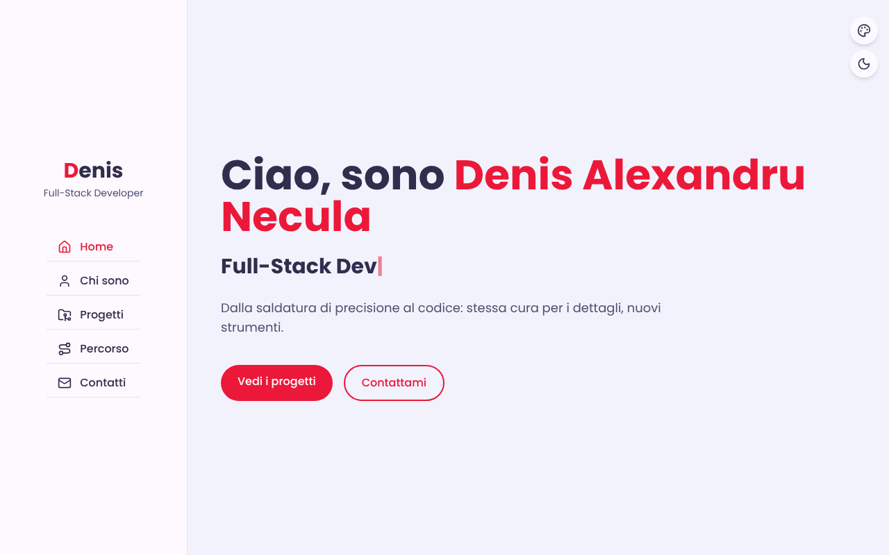
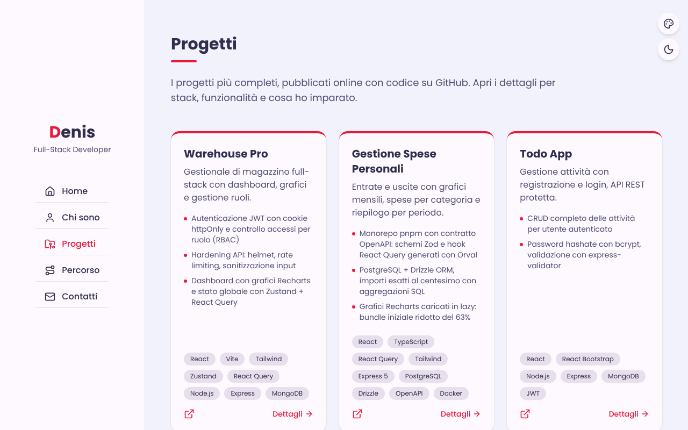

# Denis Necula — Portfolio

Portfolio personale di **Denis Alexandru Necula**, Full-Stack Developer.

**Online:** https://denis-portfolio-eta.vercel.app



## Pagine

| Percorso | Contenuto |
|---|---|
| `/` | Presentazione con ruoli animati |
| `/chi-sono` | Bio, competenze e formazione |
| `/progetti` | Progetti principali con stack, punti chiave e demo live |
| `/progetti/:slug` | Dettaglio di un progetto |
| `/percorso` | Timeline dei progetti, dal bootcamp a oggi |

Tema colore intercambiabile (5 palette) e modalità scura, salvati nel browser.



## Stack

React 19 · TypeScript · Vite · Tailwind CSS v4 · React Router · lucide-react · deploy su Vercel

## Struttura

```
src/
├── data/          contenuti tipizzati: profile.ts, journey.ts, projectDetails.ts
├── components/    sezioni e card riutilizzabili
├── pages/         una pagina per route
└── hooks/         tema, titolo pagina, ruoli animati
```

Testi e progetti si modificano solo in `src/data/`: nessun componente da toccare.

## Avvio in locale

```bash
npm install
npm run dev       # http://localhost:5173
npm run build     # build di produzione in dist/
```

## Nota sui link al codice

I repository dei progetti sono privati per ora: nelle card resta il link alla demo live.
Per rimettere il link al codice, togli il commento a `repoUrl` in `src/data/profile.ts` e `src/data/journey.ts`.
